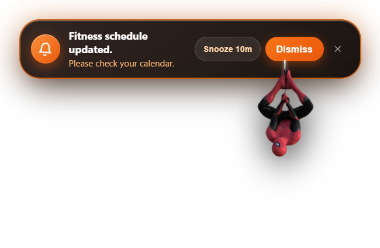
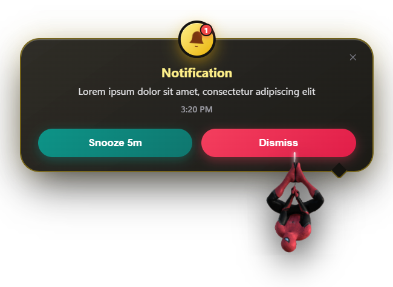
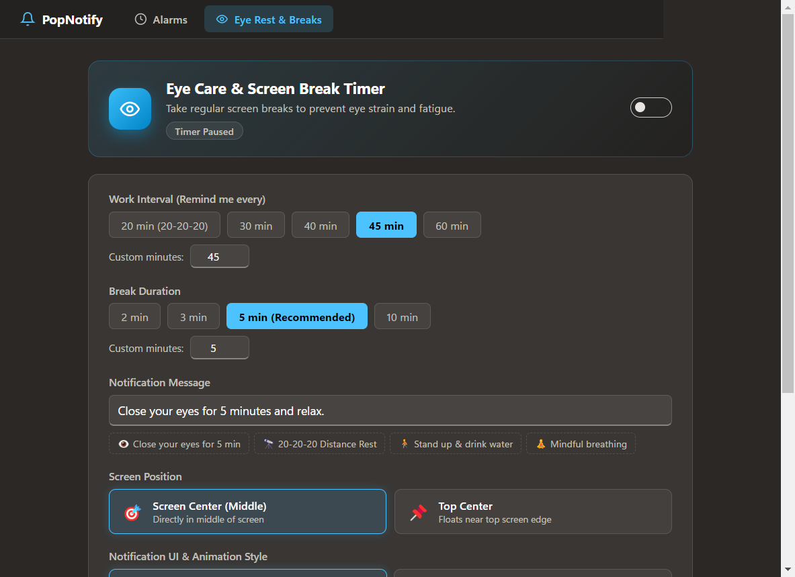
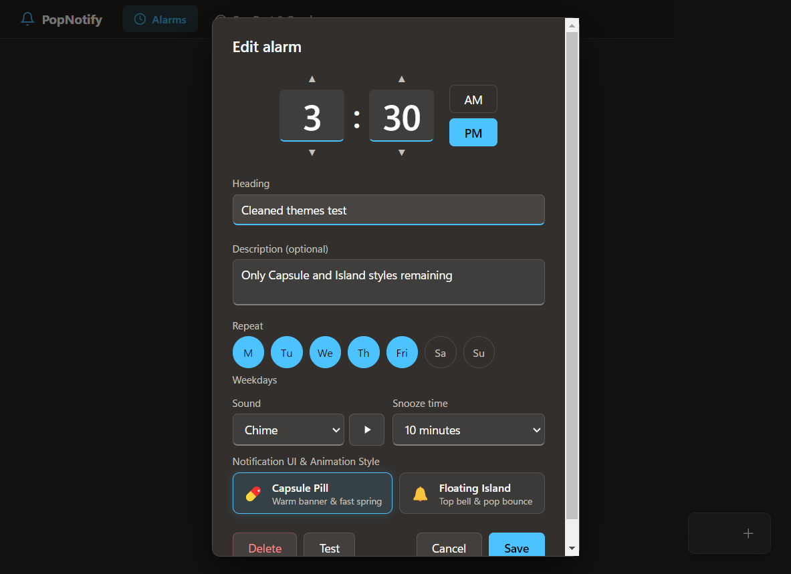

# 🕸️ Web-Alert

> **A sleek, modern Windows desktop notification, alarm, and screen-break timer with smooth spring animations and a playful Spider-Man companion.**

---

## ✨ Features

- 💊 **Dual Notification Themes:**
  - **Capsule Pill:** Warm floating pill banner with rapid spring physics.
  - **Floating Island:** Dynamic top island notification with pop bounce effects.
- 🕷️ **Spider-Man Companion:** Spider-Man drops down on an elastic web thread right below your notifications, checking on your alerts with an organic swinging pendulum animation.
- 👁️ **Eye Care & Screen Break Timer:**
  - Automated 20-20-20, 30m, 40m, or 45-minute customizable work intervals.
  - Prominent **Middle-of-Screen** popups with custom snooze and rest durations to keep your eyes healthy.
  - Live countdown ticker in the settings tab.
- 🔔 **Customizable Alarms & Reminders:** Set one-time or recurring weekly alarms with synthesized Web Audio chimes.
- ⚡ **Lightweight & Offline:** Pure Electron, zero bloated frameworks, standalone and works 100% offline.

---

## 📸 Notification UI Previews

### 1. Capsule Pill Notification
*Sleek pill banner with action buttons and Spider-Man hanging below by his glowing web thread:*

<p align="center">
  
</p>

---

### 2. Floating Island Notification
*Dynamic island banner featuring top bell badge and bounce animation:*

<p align="center">
  
</p>

---

### 3. Eye Care & Screen Break Dashboard
*Dedicated interval manager for 20m, 30m, 40m, or 45m screen breaks with center-screen alerts:*

<p align="center">
  
</p>

---

### 4. Alarm & Reminder Setup Dialog
*Clean, modal configuration for schedule, custom chime sounds, and notification style selection:*

<p align="center">
  
</p>

---

## 🚀 Getting Started

### Prerequisites
Make sure you have [Node.js](https://nodejs.org/) (LTS recommended) installed on your system.

### Installation & Run

1. **Clone the repository:**
   ```bash
   git clone https://github.com/soorajstudio/Web-Alert.git
   cd Web-Alert
   ```

2. **Install dependencies:**
   ```bash
   npm install
   ```

3. **Start the app:**
   ```bash
   npm start
   ```

---

## 📦 Building Standalone Executables (.exe)

To build the standalone Windows executable and setup installer:

```bash
npm run build
```

The output will be created inside the `dist/` directory:
- **`dist/win-unpacked/PopNotify.exe`** — Direct standalone executable (runs immediately without installation).
- **`dist/PopNotify-Setup-2.0.0.exe`** — Windows NSIS setup installer.

---

## 🛠️ Tech Stack

- **Runtime:** [Electron](https://www.electronjs.org/)
- **UI:** Pure HTML5, CSS3 Variables, CSS Grid/Flexbox
- **Animations:** Web Animations API (`element.animate()`) with custom cubic-bezier spring curves
- **Audio:** Web Audio API procedural synthesizers (`sounds.js`) — no external MP3 dependencies

---

## 📄 License

ISC License © 2026 [soorajstudio](https://github.com/soorajstudio)
